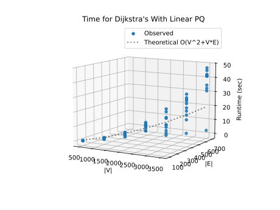
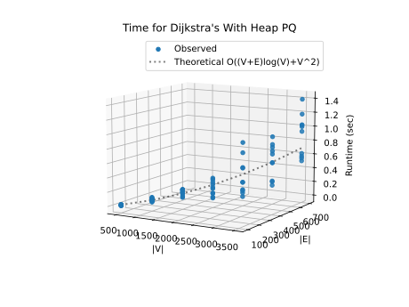
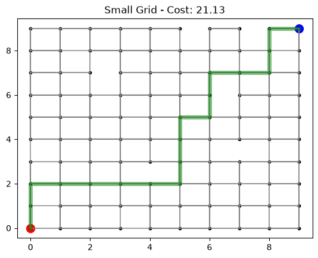
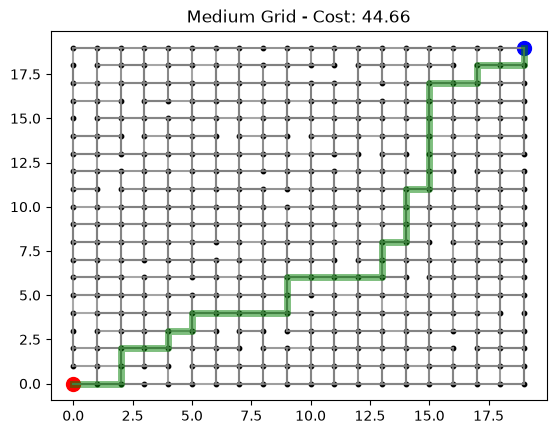
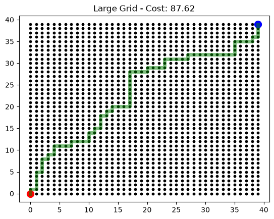

# Project Report - Network Routing

## Baseline

### Design Experience

*Fill me in*

### Theoretical Analysis - Dijkstra's With Linear PQ


#### Time 

```python
def find_shortest_path_with_linear_pq(
        graph: dict[int, dict[int, float]],
        source: int,
        target: int
) -> tuple[list[int], float]:

    distances = {node: math.inf for node in graph.keys()}        # O(V) - iterates all V vertices
    distances[source] = 0.0                                      # O(1)

    previousNodes = {node: None for node in graph.keys()}        # O(V)
    unvisited = list(graph.keys())                               # O(V)

    while len(unvisited) > 0:                                    # O(V) - loops at most V times
        currentNode = None                                       # O(1)
        minDist = math.inf                                       # O(1)
        for node in unvisited:                                   # O(V) per iteration -> O(V^2) total
            if distances[node] < minDist:                        # O(1)
                minDist = distances[node]                        # O(1)
                currentNode = node                               # O(1)

        if currentNode is None or currentNode == target:         # O(1)
            break                                                # O(1)

        unvisited.remove(currentNode)                            # O(V) list removal -> O(V^2) total

        for neighbor, weight in graph[currentNode].items():      # O(E) - total iterations across all while loops
            if neighbor in unvisited:                            # O(V) list lookup -> O(V * E) total
                newDistance = distances[currentNode] + weight    # O(1)

                if newDistance < distances[neighbor]:            # O(1)
                    distances[neighbor] = newDistance            # O(1)
                    previousNodes[neighbor] = currentNode        # O(1)

    path = []                                                    # O(1)
    current = target                                             # O(1)

    if previousNodes[current] is not None or current == source:  # O(1)
        while current is not None:                               # O(V) - max path length is V
            path.insert(0, current)                              # O(V) list insertion -> O(V^2) total
            current = previousNodes[current]                     # O(1)

    if not path and source != target:                            # O(1)
        return [], float('inf')                                  # O(1)

    return path, distances[target]                               # O(1)
```
The outer loop runs V times. In it finding and removing the smallest node takes O(V). The other loop interates over E edges and checks them against the unvisited ones in O(V). That gives a total time complexity of **O(V^2+V*E)**
#### Space

```python
def find_shortest_path_with_linear_pq(
        graph: dict[int, dict[int, float]],
        source: int,
        target: int
) -> tuple[list[int], float]:

    distances = {node: math.inf for node in graph.keys()}        # O(V) - stores 1 entry per vertex
    distances[source] = 0.0

    previousNodes = {node: None for node in graph.keys()}        # O(V) - stores 1 entry per vertex
    unvisited = list(graph.keys())                               # O(V) - stores 1 entry per vertex

    while len(unvisited) > 0:
        currentNode = None
        minDist = math.inf
        for node in unvisited:
            if distances[node] < minDist:
                minDist = distances[node]
                currentNode = node

        if currentNode is None or currentNode == target:
            break

        unvisited.remove(currentNode)

        for neighbor, weight in graph[currentNode].items():
            if neighbor in unvisited:
                newDistance = distances[currentNode] + weight

                if newDistance < distances[neighbor]:
                    distances[neighbor] = newDistance
                    previousNodes[neighbor] = currentNode

    path = []                                                    # O(V) - worst-case path contains all vertices
    current = target

    if previousNodes[current] is not None or current == source:
        while current is not None:
            path.insert(0, current)
            current = previousNodes[current]

    if not path and source != target:
        return [], float('inf')

    return path, distances[target]
```
The functions space complexity is simple all list and dictionaries stoare at most V entries each for a space complexity of **O(V)**

### Empirical Data - Dijkstra's With Linear PQ

| Size | Density | Time (sec) |
| ---- | ------- | ---------- |
| 500  | 0.2     | 0.078      |
| 1000 | 0.2     | 0.81       |
| 1500 | 0.2     | 2.956      |
| 2000 | 0.2     | 7.627      |
| 2500 | 0.2     | 9.083      |
| 3000 | 0.2     | 18.965     |
| 3500 | 0.2     | 35.857     |

### Comparison of Theoretical and Empirical Results - Dijkstra's With Linear PQ

- Theoretical order of growth: **O(V^2+V*E)**
- Empirical order of growth (if different from theoretical): Matches Theoretical



My theoretical analysis and the empirically measured values match

## Core

### Design Experience

*Fill me in*

### Theoretical Analysis - Dijkstra's With Heap PQ

#### Time

```python
def find_shortest_path_with_heap(graph, source, target):
    distances = {}
    previousNodes = {}

    for node in graph.keys():                                   # O(V) setup
        distances[node] = math.inf
        previousNodes[node] = None

    distances[source] = 0.0

    pq = MinHeap()
    pq.heap.append([0.0, source])
    pq.pos[source] = 0

    idx = 1
    for node in graph.keys():                                   # O(V) heap init
        if (node != source):
            pq.heap.append([math.inf, node])
            pq.pos[node] = idx
            idx += 1

    while (not pq.isEmpty()):                                   # O(V) iterations
        currentNode, currentDist = pq.extractMin()              # O(log V) -> O(V log V) total

        if (currentDist == math.inf or currentNode == target):
            break

        for neighbor in graph[currentNode].keys():              # O(E) total across all loops
            weight = graph[currentNode][neighbor]
            if (pq.contains(neighbor)):                         
                newDist = currentDist + weight

                if (newDist < distances[neighbor]):
                    distances[neighbor] = newDist
                    previousNodes[neighbor] = currentNode
                    pq.decreaseKey(neighbor, newDist)           # O(log V) -> O(E log V) total

    path = []
    current = target

    if (previousNodes[current] is not None or current == source):
        while (current is not None):                            # O(V) max length
            path.insert(0, current)                             # O(V) insertion -> O(V^2) total
            current = previousNodes[current]

    if (len(path) == 0 and source != target):
        return [], math.inf

    return path, distances[target]
```
The time complexity of the heap variation is dominated by the main loop. Pulling out the Min node V times takes O(V log(V)). Updating the new distances between nodes for every E edge takes O(E log(V)). Then constructing the path has a worst case of O(V^2). 

This leaves us with a total time of **O((V+E)log(V)+V^2)**

#### Space

```python
def find_shortest_path_with_heap(graph, source, target):
    distances = {}                                              # O(V) - 1 entry per vertex
    previousNodes = {}                                          # O(V) - 1 entry per vertex

    for node in graph.keys():
        distances[node] = math.inf
        previousNodes[node] = None

    distances[source] = 0.0

    pq = MinHeap()                                              # O(V) - heap array and pos dictionary 

    pq.heap.append([0.0, source])
    pq.pos[source] = 0

    idx = 1
    for node in graph.keys():
        if (node != source):
            pq.heap.append([math.inf, node])
            pq.pos[node] = idx
            idx += 1

    while (not pq.isEmpty()):
        currentNode, currentDist = pq.extractMin()

        if (currentDist == math.inf or currentNode == target):
            break

        for neighbor in graph[currentNode].keys():
            weight = graph[currentNode][neighbor]
            if (pq.contains(neighbor)):
                newDist = currentDist + weight

                if (newDist < distances[neighbor]):
                    distances[neighbor] = newDist
                    previousNodes[neighbor] = currentNode
                    pq.decreaseKey(neighbor, newDist)

    path = []                                                   # O(V) - worst-case path length is V
    current = target

    if (previousNodes[current] is not None or current == source):
        while (current is not None):
            path.insert(0, current)
            current = previousNodes[current]

    if (len(path) == 0 and source != target):
        return [], math.inf

    return path, distances[target]
```

Similar to the linear case the space of the formula is restricted to several structures that are no larger than **O(V)**

### Empirical Data - Dijkstra's With Heap PQ

| Size | Density | Time (sec) |
| ---- | ------- | ---------- |
| 500  | 0.2     | 0.011      |
| 1000 | 0.2     | 0.061      |
| 1500 | 0.2     | 0.143      |
| 2000 | 0.2     | 0.18       |
| 2500 | 0.2     | 0.323      |
| 3000 | 0.2     | 0.529      |
| 3500 | 0.2     | 0.879      |


### Comparison of Theoretical and Empirical Results - Dijkstra's With Heap PQ

- Theoretical order of growth: **O((V+E)log(V)+V^2)**
- Empirical order of growth (if different from theoretical): Matches Theoretical



My theoretical analysis and the empirically measured values match

### Relative Performance Of Linear versus Heap PQ Performance

The two algorithms have equivalent space requirements. For time the heap implementation is vastly more efficient than the linear solution in sparse cases such as the ones tested hear. In cases of highly dense graphs the two are about equivalent 

## Stretch 1

### Design Experience

*Fill me in*

### Empirical Data


| V    | Density | heap time (sec) | linear PQ time (sec) |
|------|---------|-----------------|----------------------|
| 500  | 0.6     | 0.008           | 0.138                |
| 1000 | 0.6     | 0.061           | 1.085                |
| 1500 | 0.6     | 0.07            | 1.667                |
| 2000 | 0.6     | 0.236           | 7.188                |
| 2500 | 0.6     | 0.37            | 22.635               |
| 3000 | 0.6     | 0.519           | 26.203               |
| 3500 | 0.6     | 0.836           | 29.998               |

| V    | Density | heap time (sec) | linear PQ time (sec) |
|------|---------|-----------------|----------------------|
| 500  | 1       | 0.026           | 0.2                  |
| 1000 | 1       | 0.112           | 2.02                 |
| 1500 | 1       | 0.258           | 5.758                |
| 2000 | 1       | 0.212           | 10.322               |
| 2500 | 1       | 0.487           | 32.973               |
| 3000 | 1       | 0.644           | 55.334               |
| 3500 | 1       | 1.237           | 83.759               |
### Plot

[plot_heap_linear_stretch1.py](plot_heap_linear_stretch1.py)

### Discussion

My Ideas from Core were a bit off as heap never aproached linear however it does look to increase faster in high density situations

## Stretch 2

### Design Experience

*Fill me in*

### Provided Graph Generation Algorithm Explanation

Main.py works by randomly generating verticies. This is controlled by the distribution function which describes there general shape. Then the density variable is used to determine the number of connections between the various vertices. Lastly noise is used to generate edge weights. This system works well for generating for modling comunications networks and other systems where edges dont realy interact and can cross without permitting swaping from edge to edge. As such it dosnt work well for more physical systems like roads as the vertices generated arnt affected by any outside physical forces such as terrain. 

### Selected Graph Generation Algorithm Explanation

I chose to make asystem that contrasted the onefound in main. It uses simple grid and each vertex is conected to the vertexs directly adjacent to it. Then to emulate somthing like construction or dead ends some of the connections are randomly removed. Lastly a small variation is given to each edge to simulate trafic. This algorithim is much better at simulating a map of a town built on a grid or with some small modifications general geographically bound systems.

#### Screenshots of Working Graph Generation Algorithm




## Project Review

*Fill me in*

