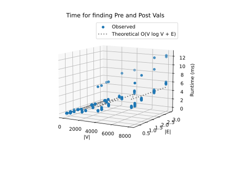
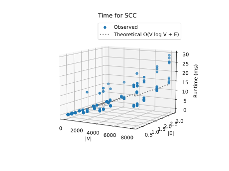

# Project Report - Network Analysis SCCs

## Baseline

### Design Experience

Due to scheduling conflicts I was unable to setup a time to meet with anyone to conduct a design review. I did do some basic planning and review of the basics of the algorithms involved in conducting a DFS. I looked at some of the psudo code in the slides and the textbook to form the basis of what I was put together for this project.

### Theoretical Analysis - Pre/Post Order Traversal
#### Time 

```python
def prepost(graph: GRAPH) -> list[dict[str, list[int]]]:
    index: int = 1                                           # O(1)
    visited: set[VERTEX]= set()                              # O(1)
    prepost: PREPOSTNUMS = []                                # O(1)

    for vertex in graph:                                     # O(V) - loops all vertices
        if vertex not in visited:                            # O(1) - set lookup
            current_component: COMPONENT = {}                # O(1)
            prepost.append(current_component)                # O(1)
            index = DFS(vertex,graph,current_component,visited,index)

    return prepost                                           # O(1)


def DFS(vertex: VERTEX, graph:GRAPH, currentComponent:COMPONENT, visited: set[VERTEX], index) -> int:
    visited.add(vertex)                                      # O(1) - set insert
    currentComponent[vertex] = [index, -1]                   # O(1) - dict insert
    index = index + 1                                        # O(1)

    for neighbor in graph.get(vertex,[]):                    # O(E) - total across all recursive calls
        if neighbor not in visited:                          # O(1) - set lookup
            index = DFS(neighbor, graph, currentComponent, visited, index) 

    currentComponent[vertex][1] = index                      # O(1)
    index = index + 1                                        # O(1)

    return index                                             # O(1)
```
The largest operation is the `for` loop in `prepost` and the corresponding calls in `DFS`. The loop in `prepost` checks every vertex V once. The `for` loop in `DFS` iterates over the neighbors of each visited vertex and traverses every edge E in the graph for every call. Since every vertex is visited once and every edge is explored, the time complexity is **O(V + E)**.

#### Space

```python
def prepost(graph: GRAPH) -> list[dict[str, list[int]]]:
    index: int = 1
    visited: set[VERTEX]= set()                              # O(V) - stores all V vertices
    prepost: PREPOSTNUMS = []                                # O(V) - stores V total entries

    for vertex in graph:
        if vertex not in visited:
            current_component: COMPONENT = {}
            prepost.append(current_component)
            index = DFS(vertex,graph,current_component,visited,index)

    return prepost


def DFS(vertex: VERTEX, graph:GRAPH, currentComponent:COMPONENT, visited: set[VERTEX], index) -> int:
    visited.add(vertex)
    currentComponent[vertex] = [index, -1]                   # O(V) - maps V vertices over time
    index = index + 1

    for neighbor in graph.get(vertex,[]):
        if neighbor not in visited:
            index = DFS(neighbor, graph, currentComponent, visited, index) # O(V) - max call stack depth

    currentComponent[vertex][1] = index
    index = index + 1

    return index
```
The `visited` set and the dictionaries stored in `prepost` will eventually store an entry for every vertex, this requires O(V) space. In the worst-case `DFS`  will add V frames to the call stack, also requiring O(V) space. Therefore, the overall space complexity is **O(V)**.

### Empirical Data
| Density |   V   | Time (ms) |
| ------- | ----- | --------- |
| 0.25    | 10    | 0.01      |
| 0.5     | 10    | 0.009     |
| 1.0     | 10    | 0.008     |
| 2.0     | 10    | 0.008     |
| 3.0     | 10    | 0.01      |
| 0.25    | 50    | 0.027     |
| 0.5     | 50    | 0.026     |
| 1.0     | 50    | 0.025     |
| 2.0     | 50    | 0.023     |
| 3.0     | 50    | 0.031     |
| 0.25    | 100   | 0.052     |
| 0.5     | 100   | 0.039     |
| 1.0     | 100   | 0.045     |
| 2.0     | 100   | 0.059     |
| 3.0     | 100   | 0.073     |
| 0.25    | 500   | 0.216     |
| 0.5     | 500   | 0.236     |
| 1.0     | 500   | 0.206     |
| 2.0     | 500   | 0.332     |
| 3.0     | 500   | 0.386     |
| 0.25    | 2000  | 0.806     |
| 0.5     | 2000  | 0.762     |
| 1.0     | 2000  | 0.964     |
| 2.0     | 2000  | 1.616     |
| 3.0     | 2000  | 1.387     |
| 0.25    | 4000  | 2.017     |
| 0.5     | 4000  | 2.134     |
| 1.0     | 4000  | 2.447     |
| 2.0     | 4000  | 3.081     |
| 3.0     | 4000  | 3.495     |
| 0.25    | 8000  | 3.213     |
| 0.5     | 8000  | 3.858     |
| 1.0     | 8000  | 4.6       |
| 2.0     | 8000  | 6.049     |
| 3.0     | 8000  | 6.997     |


### Comparison of Theoretical and Empirical Results

- Theoretical order of growth: O(V+E) 
- Empirical order of growth (if different from theoretical): O(V+E) 



The Observed rate of growth matched that of my theoretical estimations.


## Core

### Design Experience
Due to scheduling conflicts I was unable to setup a time to meet with anyone to conduct a design review. I did some basic planning building on= what was done for basline. specificlay i looked into what would be needed to implement SCC.


### Theoretical Analysis - SCC

#### Time 
```python
def find_sccs(graph: GRAPH) -> list[set[str]]:
    prepostNumbers: PREPOSTNUMS = prepost(graph)             # O(V + E) 
    postEntries: list[tuple[int,VERTEX]] = []                # O(1) 

    for tree in prepostNumbers:                              # O(V)iterates across all V vertices
        for vertex,number in tree.items():                   # O(1) 
            postNum = number[1]                              # O(1) 
            postEntries.append((postNum,vertex))             # O(1)

    postEntries.sort(reverse=True)                           # O(V log V) - sorting V tuples
    finishOrder = [vertex for postNum,vertex in postEntries] # O(V) - list comprehension over V items

    reversedGraph: GRAPH = reverse_graph(graph)              # O(V + E) - transposes graph adjacency list

    visited: set[VERTEX] = set()                             # O(1) 
    sccs: list[set[VERTEX]] = []                             # O(1) 

    for vertex in finishOrder:                               # O(V) - iterates through finish order
        if vertex not in visited:                            # O(1) 
            currentScc: set[VERTEX] = set()                  # O(1) 
            collect_scc(vertex,reversedGraph,visited,currentScc) # O(V + E) TOTAL across all outer calls
            sccs.append(currentScc)                          # O(1) 

    sccs.reverse()                                           # O(V)
    return sccs                                              # O(1)


def reverse_graph(graph: GRAPH) -> GRAPH:
    reversed_graph: GRAPH = {                                # O(V) - creates dict with V keys
        vertex: []
        for vertex in graph
    }

    for vertex, neighbors in graph.items():                  # O(V) - outer loop over vertices
        for neighbor in neighbors:                           # O(E) TOTAL - inner loop runs E times across all vertices
            reversed_graph[neighbor].append(vertex)          # O(1) 

    return reversed_graph                                    # O(1) 


def collect_scc(vertex: VERTEX,graph: GRAPH,visited: set[VERTEX],current_scc: set[VERTEX]) -> None:
    visited.add(vertex)                                      # O(1) 
    current_scc.add(vertex)                                  # O(1)

    for neighbor in graph.get(vertex, []):                   # Traverses outgoing edges of vertex
        if neighbor not in visited:                          # O(1) 
            collect_scc(neighbor,graph,visited,current_scc)  # O(V + E) Recursive DFS call
```

- `reverse_graph` initializes V keys and iterates through E total edges, running in O(V + E) time.
- `collect_scc` is a DFS traversal. As `find_sccs` iterates, each vertex and reversed edge is visited once, taking O(V + E) time.
- `find_sccs` calls prepost O(V + E), collects post numbers O(V), sorts V post numbers O(V \log V), reverses the graph O(V + E), and collects components O(V + E.

The sorting step O(V log V) grows teh quickest, making the overall time complexity **O(V log V + E)**.

#### Space
```python
def find_sccs(graph: GRAPH) -> list[set[str]]:
    prepostNumbers: PREPOSTNUMS = prepost(graph)             # O(V) - stores numbers for V vertices
    postEntries: list[tuple[int,VERTEX]] = []                # O(V) - stores V tuples

    for tree in prepostNumbers:
        for vertex,number in tree.items():
            postNum = number[1]
            postEntries.append((postNum,vertex))

    postEntries.sort(reverse=True)
    finishOrder = [vertex for postNum,vertex in postEntries] # O(V) - stores V vertex labels
    reversedGraph: GRAPH = reverse_graph(graph)              # O(V + E) - stores V keys and E transposed edge lists
    visited: set[VERTEX] = set()                             # O(V) - set containing up to V vertices
    sccs: list[set[VERTEX]] = []                             # O(V) - set storing all V vertices
    
    for vertex in finishOrder:
        if vertex not in visited:
            currentScc: set[VERTEX] = set()

            collect_scc(vertex,reversedGraph,visited,currentScc)
            sccs.append(currentScc)

    sccs.reverse()
    return sccs


def reverse_graph(graph: GRAPH) -> GRAPH:
    reversed_graph: GRAPH = {                                # O(V + E) - dictionary holding V keys and E total items
        vertex: []
        for vertex in graph
    }
    for vertex, neighbors in graph.items():
        for neighbor in neighbors:
            reversed_graph[neighbor].append(vertex)

    return reversed_graph


def collect_scc(vertex: VERTEX,graph: GRAPH,visited: set[VERTEX],current_scc: set[VERTEX]) -> None:
   visited.add(vertex)
    current_scc.add(vertex)

    for neighbor in graph.get(vertex, []):
        if neighbor not in visited:
            collect_scc(neighbor,graph,visited,current_scc)   # O(V) - worst-case call stack depth during DFS traversal
```
- `collect_scc` uses at wort O(V) memory for the recursion call stack
- `visited`, `sccs`, `finishOrder`, `postEntries`, and `prepostNumbers` each store O(V) elements.
- `reversedGraph` creates a graph containing V vertex entries and E edge elements, requiring O(V + E).

`reversedGraph` stores the most making the overal space complexity **O(V+E)**

### Empirical Data

| Density |   V   | Time (ms) |
| ------- | ----- | --------- |
| 0.25    | 10    | 0.027     |
| 0.5     | 10    | 0.022     |
| 1.0     | 10    | 0.022     |
| 2.0     | 10    | 0.024     |
| 3.0     | 10    | 0.022     |
| 0.25    | 50    | 0.08      |
| 0.5     | 50    | 0.069     |
| 1.0     | 50    | 0.067     |
| 2.0     | 50    | 0.06      |
| 3.0     | 50    | 0.078     |
| 0.25    | 100   | 0.125     |
| 0.5     | 100   | 0.127     |
| 1.0     | 100   | 0.122     |
| 2.0     | 100   | 0.161     |
| 3.0     | 100   | 0.196     |
| 0.25    | 500   | 0.567     |
| 0.5     | 500   | 0.574     |
| 1.0     | 500   | 0.676     |
| 2.0     | 500   | 0.805     |
| 3.0     | 500   | 1.085     |
| 0.25    | 2000  | 2.077     |
| 0.5     | 2000  | 3.188     |
| 1.0     | 2000  | 2.36      |
| 2.0     | 2000  | 3.949     |
| 3.0     | 2000  | 3.851     |
| 0.25    | 4000  | 5.061     |
| 0.5     | 4000  | 6.178     |
| 1.0     | 4000  | 5.581     |
| 2.0     | 4000  | 7.105     |
| 3.0     | 4000  | 9.324     |
| 0.25    | 8000  | 11.552    |
| 0.5     | 8000  | 12.412    |
| 1.0     | 8000  | 12.908    |
| 2.0     | 8000  | 16.088    |
| 3.0     | 8000  | 20.745    |


### Comparison of Theoretical and Empirical Results

- Theoretical order of growth: **O(V log V + E)**
- Empirical order of growth (if different from theoretical):  **O(V log V + E)**



The Observed rate of growth matched that of my theoretical estimations.

## Stretch 1

### Design Experience

I didnt think I was gonna have time for this one so just did some research as I got to it and had some time left

### Articulation Points Discussion 

Articulation points are important in any field that is critically important as they represent a signal point of failure in a given network. This is important in things like the energy grid as if an articulating vertex goes down areas can be left fully without power. Additionally they are important to account for when transporting things as they can lead to bottlenecks if a large number of vehicles are trying to get through exceeding the capacity of the vertex for throughput.

## Stretch 2

### Design Experience

*Fill me in*

### Dataset Description

*Fill me in*

### Findings Discussion

*Fill me in*

## Project Review

*Fill me in*
